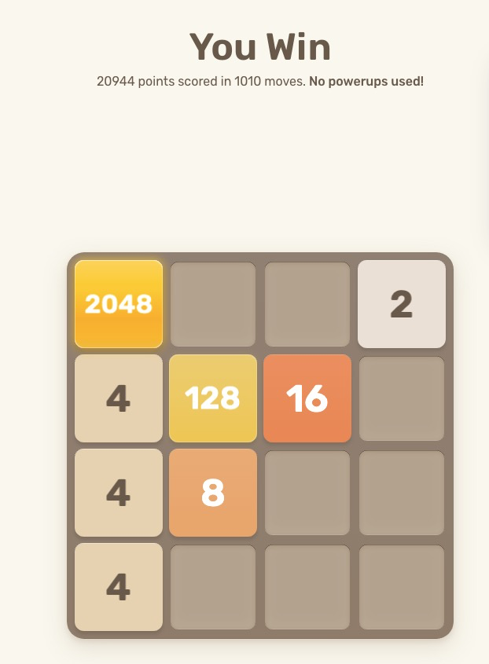

# 2048 Move Advisor

[English](README.md)

[play2048.co](https://play2048.co/) の現在の盤面を読み取り、2048タイルの達成を優先して次の一手を提案するChrome拡張です。提案は矢印で表示されます。オートモードでは、提案された手を一定間隔で自動的にプレイできます。



*パワーアップを使わず、1,010手で2048を達成。*

## インストール

1. `npm install` で依存関係をインストールします。
2. `npm run build` で拡張機能をビルドします。
3. Chromeで `chrome://extensions/` を開きます。
4. 右上の「デベロッパー モード」を有効にします。
5. 「パッケージ化されていない拡張機能を読み込む」をクリックします。
6. このリポジトリの `dist/` ディレクトリを選択します。
7. [play2048.co](https://play2048.co/) を開くか、すでに開いているページを再読み込みします。

ページ上に「2048 ADVISOR」パネルが表示されます。盤面が変わるたびに次の一手を再計算します。トップページのStandardモードと `/classic` のClassicモードに対応しています。

## オートモード

「オート開始」をクリックすると、提案された手を自動的にプレイします。「オート停止」をクリックすると手動プレイに戻ります。

オートモードは次の場合に自動停止します。

- 2048タイルを達成した場合
- ゲームオーバーになった場合
- 操作しても盤面が変化しなかった場合
- 盤面を読み取れなくなった場合

自動操作の直前には、現在の盤面が提案を計算したときの盤面と一致することを確認します。盤面が変化した後に古い提案を実行してしまうことを防ぎます。

## 手の決め方

新しいタイルはランダムに出現するため、必ず成功する唯一の手順はありません。この拡張は、2のタイルが90%、4のタイルが10%の確率で出現する標準ルールに基づいてexpectimax探索を行います。

盤面の評価では次の状態を重視します。

- 2048タイルを作れる手
- 空きマスが多い盤面
- 最大のタイルを角に保てる配置
- 大きなタイルが単調に並ぶ配置
- 次の手で合体できる組み合わせ

探索はWeb Workerで実行されるため、ゲーム画面の操作を妨げにくい構成です。盤面データはすべてブラウザ内で処理され、外部には送信されません。

## ビルド

読み込み可能な拡張機能をビルドするには次を実行します。

```sh
npm run build
```

## 開発

Node.jsでテストを実行できます。

```sh
npm test
```
